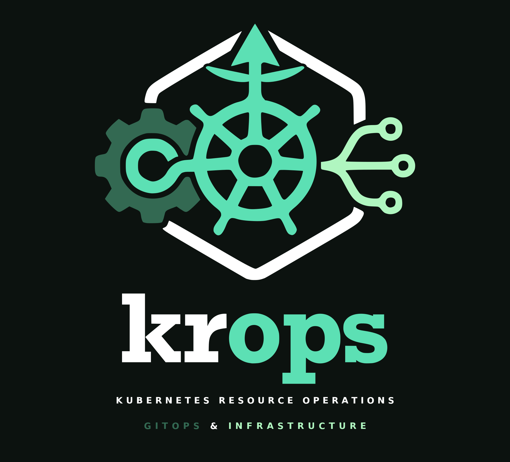

# krops



krops is a working reference that manages cloud infrastructure the way you
manage workloads: everything is declarative YAML in Git, and controllers
continuously reconcile the clusters to match. No Terraform, no HCL, no state
file, no second toolchain.

You get a Kubernetes platform with Cluster API building the clusters, Flux
delivering every resource from this repository, and each cloud's native
operator (ACK on AWS, Azure Service Operator, Config Connector on GCP)
reconciling cloud resources. One API, one RBAC model, one audit trail for
infrastructure and workloads. See
[Architecture](docs/architecture.md) for how the pieces fit, and
[Crossplane as a resource plane](docs/crossplane.md) for where Crossplane
overlaps the pattern and where its scope differs.

The repository demonstrates the pattern end to end on AWS EKS, Azure AKS,
Google GKE, local Docker clusters, and a Tinkerbell-provisioned
[Talos Linux](https://www.talos.dev/) machine. A disposable
[kind](https://kind.sigs.k8s.io/) cluster bootstraps Flux, Cluster API pivots
control to a self-managed management cluster, and the
[`krops-bootstrap`](docs/bootstrap-cli.md) CLI runs bootstrap, pivot, and
teardown. It is a reference, not a product: fork it, strip it down, and adapt
it to your own cloud and clusters.

## What you get

- Self-managed management and workload clusters on AWS, Azure, GCP, your
  laptop (Docker), or bare-metal Talos, all from one repository shape.
- One Git repository as the source of truth: change a file, merge it, and the
  clusters converge to match.
- Every pull request reviewed as a rendered Flux diff by
  [konflate](docs/konflate.md): you approve byte-for-byte what will reconcile.
- Secrets encrypted in Git with [SOPS + age](docs/secrets.md); cloud
  credentials never sit on workload clusters.
- An [air-gapped bundle](docs/airgap.md) of the local environment for fully
  disconnected installs.

## Quickstart

You need only a container engine: Docker, or Podman 5.5+. The
`krops-toolbox` container carries every lifecycle tool, so nothing else is
installed on the host.

```sh
git clone https://github.com/polarsquad/krops.git
cd krops
scripts/toolbox-run.sh bootstrap local-host
```

That one command starts a local registry and a kind cluster, publishes this
checkout to it, installs Flux and Cluster API, pivots into a self-managed
management cluster, and reconciles a workload cluster running the Podinfo
demo app. When it exits, watch what landed:

```sh
export KUBECONFIG="$PWD/.kube/krops-mgmt.yaml"
flux get kustomizations
```

Then open the workload app (the port-forward publishes the port from the
toolbox, so a host browser reaches it):

```sh
export TOOLBOX_IMAGE=ghcr.io/polarsquad/krops-toolbox:latest   # or krops-toolbox:dev
docker run --rm -it \
  -v "$PWD:/workspace" -w /workspace \
  -v /var/run/docker.sock:/var/run/docker.sock \
  -v "$PWD/.kube:/root/.kube" \
  -e KUBECONFIG=/workspace/.kube/krops-mgmt.yaml \
  -e MISE_AUTO_INSTALL=0 --network kind -e KROPS_TOOLBOX=1 \
  --entrypoint mise "$TOOLBOX_IMAGE" -E local-host run kubeconfigs
docker run --rm --network kind -p 9898:9898 -v "$PWD:/workspace" -w /workspace \
  --entrypoint kubectl "$TOOLBOX_IMAGE" --kubeconfig local-workload.kubeconfig \
  port-forward --namespace podinfo --address 0.0.0.0 service/podinfo 9898:9898
```

Browse to <http://localhost:9898>.

Tear the whole stack down again with:

```sh
scripts/toolbox-run.sh teardown local-host
```

On macOS, the exported management kubeconfig points at the `kind` Docker
network, which Docker Desktop does not route; rewrite a host copy before the
`export` above. Linux hosts need no rewrite. See
[Host-side access after a toolbox local-host run (macOS)](docs/operations.md#host-side-access-after-a-toolbox-local-host-run-macos).

To try a cloud environment instead, prepare the account once (an AWS
CloudFormation stack, an Azure resource group, or a GCP workload identity
pool), fill in `.env` from `.env.example`, and run the same two commands with
`aws`, `azure`, or `gcp`. Each cloud page walks its preparation:

| Environment | Management cluster | Guide |
|---|---|---|
| `aws` (reference) | EKS in `eu-north-1` | [docs/aws.md](docs/aws.md) |
| `azure` | AKS in `swedencentral` | [docs/azure.md](docs/azure.md) |
| `gcp` | GKE in `europe-north1` | [docs/gcp.md](docs/gcp.md) |
| `local-host` | kind (Docker) | [docs/operations.md](docs/operations.md) |
| `local-talos` | Talos on bare metal | [docs/operations.md](docs/operations.md) |
| air-gapped `local-host` | kind, zero external traffic | [docs/airgap.md](docs/airgap.md) |

## Who this is for

Platform engineers who already run Kubernetes and want to manage cloud
infrastructure with the same API, RBAC, and GitOps workflow they use for
workloads. If you reach for Terraform or Pulumi to stand up cloud resources
for Kubernetes, this pattern is the alternative: the cluster you already
operate becomes the control plane. You do not need to be a Kubernetes expert
to run the quickstart; the deep guides assume you are comfortable operating
clusters.

## Going deeper

- [Architecture](docs/architecture.md): pillars, reconciliation order, per-environment detail
- [Operations](docs/operations.md): toolbox, prerequisites, bootstrap, pivot recovery, teardown, validation
- [Bootstrap CLI](docs/bootstrap-cli.md): the `krops-bootstrap` engine and its configuration
- [Secrets](docs/secrets.md): SOPS + age key setup and credential rotation
- [Dependencies](docs/dependencies.md): Renovate-managed updates across the repository
- [Extending](docs/extending.md): adding clusters, apps, and providers
- [AWS IAM](docs/aws-iam.md), [Workload resources](docs/workload-resources.md),
  [ACK troubleshooting](docs/troubleshooting-ack.md)
- [konflate](docs/konflate.md): rendered PR review, the Actions gate, and write-back
- [Air-gapped krops](docs/airgap.md): Zarf bundle build, offline deploy, update drill
- [Proposals](docs/proposals/README.md): design proposals, under review or accepted

## Repository layout

```
.
├── mgmt/<env>/                Reconciled by the MANAGEMENT cluster's Flux
│   ├── infrastructure/        Platform components and cloud-resource controllers
│   ├── capi-providers/        Cluster API and its infrastructure providers
│   ├── addons/                What gets installed on workload clusters
│   └── clusters/              Cluster definitions (workload + self-managed management)
├── workload/<env>/            Reconciled by each WORKLOAD cluster's Flux
├── airgap/                    Zarf offline bundle for the local-host profile
├── bootstrap-rs/              The krops-bootstrap CLI and the toolbox image
├── bootstrap.toml             Repository-owned lifecycle configuration
├── scripts/toolbox-run.sh     Docker/Podman wrapper: the lifecycle entry point
├── docs/                      Detailed documentation (links above)
├── tests/                     Validation gates (run by `mise run validate`)
└── .github/workflows/         CI: validate, toolbox release, docs, konflate
```

`mgmt/` and `workload/` carry one folder per environment (`aws`, `azure`,
`gcp`, `local-host`, `local-talos`); each component pairs a plain kustomize
root with a Flux `Kustomization`. The
[Operations](docs/operations.md) and
[Architecture](docs/architecture.md) pages walk the full tree.

## Validation

Every change is gated by `mise run validate` (host) and CI: shell scripts
parse, `bootstrap.toml` cross-checks against the Git manifests, every
kustomization under `mgmt/` and `workload/` builds, air-gap image pins hold,
and the docs site assembles with strict link checking. The Rust CLI has its
own fmt/clippy/test gate. See [Operations: Validation](docs/operations.md#validation).

## Contributing

Read [CONTRIBUTING.md](CONTRIBUTING.md) for the branch and commit
conventions, and [AGENTS.md](AGENTS.md) for the rules AI coding agents
follow. Flux tracks `main`: nothing reconciles until it is merged.

## License

Apache-2.0. See [LICENSE](LICENSE).
