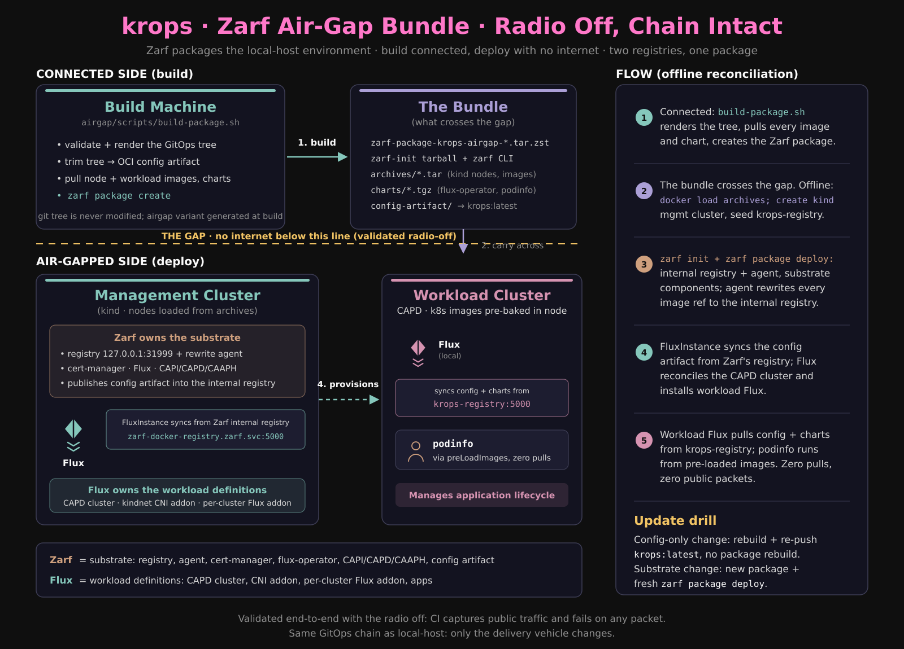

# Air-gapped krops with Zarf (local-host / CAPD environment)

This document describes how krops is packaged with [Zarf](https://zarf.dev)
on a connected machine and deployed end-to-end with **no internet access**:
the management cluster, Flux, CAPI, and a CAPD workload cluster, all from one
package plus a small set of image archives.



Status: **validated with the radio off** (2026-08-18). Rehearsed connected on
an isolated `airgap-mgmt` cluster + a renamed `airgap-wl` workload cluster
(coexisting with the live baseline), then deployed and verified end-to-end by
the autonomous script `scripts/offline-run.sh` with Wi-Fi disabled for the
full deploy + reconcile window. Re-run that script the same way to
re-verify.

By default, `offline-run.sh` waits until it confirms that the internet is
unreachable before deploying. Set `SKIP_OFFLINE_CHECK=1` only when the caller
enforces network isolation and monitors external traffic for the full run; in
that mode, the result log explicitly records that the connectivity check was
skipped and caller-monitored.

```sh
# Caller must enforce isolation and monitor external traffic until completion.
SKIP_OFFLINE_CHECK=1 airgap/scripts/offline-run.sh
```

## Prerequisites

The bundle is single-architecture (arm64), including the pinned Zarf CLI. The
mise pin in `mise.toml` selects the matching Linux or macOS arm64 release
asset. Docker and kind are also required on the deploy host (the prototype
keeps kind as the management-cluster substrate; see Known limitations).

CI requires every external image in an air-gap inventory or script changed by
a pull request to use `repository:readable-tag@sha256:<digest>`. The tag
documents the selected version; the digest makes the fetched content
immutable. Untouched legacy files are migrated when first changed. Run
`python3 airgap/tests/test-airgap-image-digests.py` (or `mise run validate`)
to check relevant working-tree changes without registry or network access.
Run `python3 airgap/tests/test-airgap-image-digests.py --all` in a clone to
audit every air-gap inventory and shell script, including untouched legacy
files.
The locally built `localhost:5001/krops-airgap:latest` config artifact is the
only documented exception because it is created immediately before packaging.

The digest must be exactly 64 hex characters; `airgap/tests/test-digest-regex.py`
regression-tests that boundary in both directions (63 and 65 characters) and
in both reference forms (`name:tag@sha256:...` and the tag-less
`name@sha256:...`). This offline check only confirms a digest is
*shaped* correctly, not that it exists. `airgap/tests/test-airgap-image-existence.py`
covers that: it queries each shape-valid pin's registry with `docker buildx
imagetools inspect` to confirm the manifest is real and pullable, catching a
well-formed but wrong digest. It only runs against pins that already parse as
shape-valid (a malformed digest is never queried), and needs registry
network access, so it runs in its own `airgap-image-existence` workflow rather
than in `mise run validate`. That workflow triggers only when `airgap/images.txt`,
the script, or the workflow file changes, keeping anonymous Docker Hub pulls
well under the rate limit.

### Image pin ownership

`zarf.yaml` is the authoritative artifact listing for the bundle: every image
in its per-component `images:` lists must also appear in `airgap/images.txt`
with the identical tag and digest. `images.txt` is the superset inventory; it
additionally carries the kind node images and workload-node images that
travel as archives, and the preload steps in `airgap/scripts` derive from the
same pins. `airgap/tests/test-airgap-ownership.py` checks that invariant in
`mise run validate` and CI, so an air-gap dependency that is updated in one
file but not the others fails the build instead of shipping a bundle with
conflicting versions or digests.

Renovate has no native zarf manager, so the air-gap surfaces are
managed by the shared custom-regex managers in `renovate.json5` rather than a
native manager. That is an accepted deviation from issue #228's "discovered
by a native Renovate manager" acceptance criterion; the ownership invariant
above is the CI-enforced guard against the partial updates #228 is about.

Every package build must be signed. For an operator build, generate or obtain
a Cosign-compatible key pair, keep the private key outside the repository, and
set `ZARF_SIGNING_KEY` to it. Set `ZARF_SIGNING_KEY_PASS` when the key is
password-protected. Transfer the corresponding public key with the bundle and
set `ZARF_VERIFY_KEY` to its gap-side path. The upstream `air-gapped` workflow
instead uses GitHub OIDC keyless signing; its Sigstore bundle and Rekor
inclusion proof are embedded in the Zarf archive and require no online lookup
at verification time.

### Dependency graph record

The per-component Syft SBOMs describe image *content*; they do not say which
chart versions were resolved, which tool versions were used, or which source
image refs mapped to which digests at build time. To close that gap, every
build renders a machine-readable dependency graph record before it ends:
`airgap/scripts/build-package.sh` step 6 runs
`airgap/scripts/render-dependency-graph.py`, which stores
`airgap/dependency-graph.json` (gitignored) next to the package archive and
prints the path.

The record is rendered from the DECLARED sources only — `airgap/images.txt`
(image refs with digests, one entry per inventory line, category `M`/`H`/`W`
as in the inventory's sections), `airgap/zarf.yaml` (per-component chart
versions, per-component images, and the release-asset URL/sha256/target
triples), `bootstrap.toml` (`[charts]` and the `kind-node-image` pin),
`mise.toml` (tool versions: zarf, clusterctl, flux, helm), and
`workload/local-host/podinfo/helm.yaml` (podinfo chart tag) — never from
pulled or live state, so the render is fully offline and cannot drift from
what the build consumed. It also fails closed when a declared source no
longer agrees with the inventory (for example a zarf.yaml image whose
digest is absent from `images.txt`).

Schema (version 1):

```json
{
  "schema_version": 1,
  "build": {"git_sha": "...", "git_ref": "...", "workflow_ref": "...",
            "timestamp_utc": "...", "package": {"name": "...", "sha256": "..."}},
  "tools": [{"name": "...", "version": "...", "pin_source": "mise.toml"}],
  "charts": [{"name": "...", "version": "...", "source_file": "..."}],
  "images": [{"ref": "...", "tag": "...", "digest": "sha256:...", "category": "M"}],
  "release_assets": [{"url": "...", "sha256": "...", "target": "..."}]
}
```

`build.workflow_ref` is set from the `air-gapped` workflow's
`github.workflow_ref` (and `build.git_ref` from `github.ref`) in CI, and is
`null`/branch-local for operator builds. The locally built
`localhost:5001/krops-airgap:latest` config artifact is the one image in
`zarf.yaml` that is not a remote digest pin and is excluded, like
`test-airgap-ownership.py`.

In the `air-gapped` workflow the record is uploaded as its own artifact,
`krops-airgap-dependency-graph`, with `retention-days: 30` — deliberately
separate from the 1-day throwaway package artifacts, so an operator can
download the few-KB record long after a nightly package has expired and
inspect exactly what that package version contains, offline. The offline
gate is `airgap/tests/test-airgap-dependency-graph.py` (in `mise run
validate` and the `air-gapped` build job, which runs `mise run validate`
before packaging): it renders the record against the repository and checks
the schema version, the required fields, that every zarf.yaml component
image and every `images.txt` line are present, and that a malformed
package digest is rejected.

## Architecture

Two registries, two image layers, one package.

```text
connected side (build)                        gap (deploy)
----------------------                        --------------
airgap/scripts/build-package.sh               airgap/scripts/offline-run.sh
  validate + render                            1. verify signature + checksums
  build-config-artifact.sh -> OCI artifact     2. extract + validate embedded SBOMs
  zarf package create (Syft SBOMs)             3. docker load + kind create + seed registry
  zarf package sign                            4. zarf init + package deploy
        |                                      zarf init --registry-mode=nodeport
        v                                      zarf package deploy
zarf-package-krops-airgap-*.tar.zst               |
archives/ (node images, workload images,           v
  charts, zarf-init tarball)                 Zarf internal registry (127.0.0.1:31999)
                                                    + agent (mutating webhook)
                                             substrate: cert-manager, flux-operator,
                                               CAPI core+providers, CAPD, CAAPH
                                             FluxInstance -> sync from Zarf registry
                                             Flux -> clusters/docker (CAPD) -> workload
                                             workload Flux <- krops-registry (config+charts)
```

**Ownership split.** Zarf owns the *substrate* (internal registry, agent,
cert-manager, the flux-operator chart, CAPI core + kubeadm bootstrap /
control-plane + CAPD component manifests, the checksum-verified CAAPH release
files, and the krops config artifact). Flux owns the *workload definitions*
(the CAPD cluster, the kindnet CNI addon, the per-cluster Flux addon),
reconciled from the config artifact.
The `mgmt/` and `workload/` trees in git are **not** modified; the airgap
variant is generated at build time by `build-config-artifact.sh`.

**Why OCI, not Gitea.** The local-host environment moved from a GitHub
`GitRepository` to an OCI-artifact sync (`oci://krops-registry:5000/krops`)
in PRs #30/#31/#33. There is no `GitRepository` left to rewrite, so the Zarf
git-server is unused; the config crosses the gap as an OCI artifact inside the
Zarf package and is published into Zarf's internal registry at deploy time.
The verification linchpin is the agent's **image rewrite** plus a Ready
`OCIRepository` pointing at the internal registry, with the radio off.

## What crosses the gap (the bundle)

| Item | Purpose |
|---|---|
| `zarf` CLI binary | runs the deploy |
| `archives/zarf-init-arm64.tar.zst` | `zarf init` (registry + agent); built by `zarf tools download-init` from the zarf CLI pinned in `mise.toml` and renamed at build time, so `mise.toml` stays the sole version declaration |
| bundled `clusterctl` CLI binaries | render CAAPH's staged provider template at deploy time on macOS or Linux arm64 |
| `zarf-package-krops-airgap-arm64-0.1.0.tar.zst` | signed package, including per-component Syft JSON/HTML SBOMs and the Sigstore signature bundle |
| `archives/kindest_node_v1.36.4_mgmt.tar` | mgmt kind node (host daemon) |
| `archives/kindest_node_v1.36.4.tar` | CAPD workload and management nodes (host daemon) |
| `archives/kindest_haproxy_*.tar` | CAPD load balancer |
| `archives/docker.io_library_registry_2.8.3.tar` | krops-registry container |
| `archives/workload-pod-images.tar` | flux controllers + podinfo for `preLoadImages` |
| `archives/charts/{flux-operator,podinfo}-*.tgz` | OCI charts seeded into krops-registry |
| `config-artifact/` | trimmed GitOps tree, re-pushed as `krops:latest` |

The CI artifact excludes the `zarf` CLI; fetch it via mise or the Zarf release
for the deploy host's target OS before crossing the gap. The package itself
contains the matching arm64 `clusterctl` binary for macOS and Linux.
CAAPH is applied by the deploy action rather than tracked as a Zarf manifest,
so `zarf package remove` does not remove it; the supported teardown deletes the
kind cluster that hosts it.

## Sequence

Connected (build):

```sh
ZARF_SIGNING_KEY=/secure/path/cosign.key airgap/scripts/build-package.sh
```

The build refuses to create an unsigned deliverable. Zarf generates
per-component Syft SBOMs by default during `package create`; the script then
signs the completed archive so its checksum manifest covers those SBOMs and
all other package contents. CI sets `ZARF_KEYLESS_SIGNING=1` and grants OIDC
only to the build job.

The `air-gapped` GitHub Actions workflow runs nightly (cron `17 2 * * *`,
default branch) or by manual dispatch, with no branch or fork guard, so a
change can be verified before merge. It builds the ARM64 bundle, then runs a
single `isolated-deploy` job that blocks new external connections from the
kind network and fails if any public packet is observed or attempted, plus a
`report-status` job that files or closes the nightly failure issue. The
workflow retains the bundle and verification evidence as one-day artifacts.

The nightly schedule starts at 02:17 UTC rather than at the top of the hour to
reduce GitHub Actions queue contention. Build and deployment remain separate
jobs so CI verifies that the uploaded transfer bundle can be downloaded and
used on clean runners; the deployment job depends only on the build job. The
bundle upload uses compression level 0 because its largest contents are
already-compressed container layers and Zstandard archives. CI also
deliberately avoids caching container images: pulling them during every run
verifies that the declared air-gap inventory remains available and complete.

Gap (deploy): from `airgap/`:

```sh
# CI keyless-signed package (default trusted workflow identity)
scripts/offline-run.sh zarf-package-krops-airgap-arm64-0.1.0.tar.zst

# Operator key-signed package
ZARF_VERIFY_KEY=/transfer/cosign.pub \
  scripts/offline-run.sh zarf-package-krops-airgap-arm64-0.1.0.tar.zst
```

Before it creates or changes a cluster, `offline-run.sh` verifies the package
signature and every archive checksum, extracts the embedded SBOMs with
signature verification forced, and decodes each document with syft's own
decoder (`zarf tools sbom convert`, the syft CLI vendored inside the zarf
binary) so invalid Syft JSON fails the run. CI performs these steps while
public egress is blocked or monitored; the extracted SBOM directory is
retained with the deployment evidence. Any verification failure aborts
before staging.

Rehearsal isolation knobs (never touch a live baseline on the same Docker
daemon): `CLUSTER_NAME`, `AIRGAP_CLUSTER_NAME`, `WORKLOAD_REGISTRY_HOST`,
`REGISTRY_NAME`, `REGISTRY_PORT`.

## Verification checklist

- The package checksum and signature verify against either the pinned upstream
  workflow identity or the explicitly supplied public key.
- Extracted SBOM JSON files are decoded by syft itself (`zarf tools sbom
  convert`); every document must decode as a Syft SBOM, and at least one
  document must be present.
- `kubectl get pods -A -o jsonpath=...`: every non-kind-baked image is
  prefixed `127.0.0.1:31999/` (the Zarf internal registry).
- `kubectl -n flux-system get ocirepository`: `url` is
  `oci://zarf-docker-registry.zarf.svc.cluster.local:5000/krops-airgap`,
  Ready with a stored digest equal to the connected-side push.
- `flux get kustomizations`: all Ready, from the artifact.
- `kubectl get clusters.cluster.x-k8s.io -A`: workload cluster `Provisioned` /
  `Available=True`; `clusterctl describe cluster` machines Running.
- Workload cluster: `kubectl get nodes` Ready; flux + podinfo pods Running.

## Empirical findings (why the package looks the way it does)

1. **CAPI provider components are clusterctl templates.** The capi-operator
   substitutes `${VAR:=default}` placeholders and applies the provider-spec
   `--feature-gates=ClusterTopology=true` arg override at install. In the gap
   we are the operator: all five providers (core, kubeadm bootstrap, kubeadm
   control-plane, CAPD, CAAPH) are fetched by Zarf from pinned upstream
   release assets, verified against their SHA-256 checksums, then rendered by
   `clusterctl` during offline deployment — `clusterctl generate provider`
   resolves the `${VAR:=default}` placeholders natively, and a `sed` step in
   each CAPI provider's Zarf action applies the `ClusterTopology=true`
   override afterward (CAAPH's render has no feature-gates flag, matching the
   repo's config, so it needs no such step).
   This replaced committed, static component snapshots (and the
   `scripts/substitute-components.sh` helper that patched them), which had no
   mechanism keeping them in sync with the digest pins Renovate manages in
   `zarf.yaml` — see issue #80's investigation for how that drifted a whole
   CAPI minor version out of sync undetected.
   The `capi-core` component stages the `clusterctl` binaries,
   `clusterctl-providers.yaml`, and `scripts/resolve-clusterctl.sh` once;
   `capi-providers` and `caaph` reuse them from `/tmp/krops-airgap` since
   they run later in the same deploy. All three components' deploy actions
   source `resolve-clusterctl.sh` rather than repeating its arch-detection
   and executable check inline (issue #354: a third copy of that block was
   the point a shared script paid off). The bundled `clusterctl` release
   itself versions independently of the providers it renders: it does not
   need to track their version, and pinning it separately is intentional,
   not a stale pin.
2. **`spec.distribution.artifact` must be omitted** from the FluxInstance.
   The operator fetches it at every reconcile and its fetcher has no
   insecure-registry option (verified: "http: server gave HTTP response to
   HTTPS client" against the plain-HTTP internal registry). Omitting it makes
   the operator use its embedded distribution manifests, the documented
   airgap default. The `flux-instance` Helm chart is unusable offline because
   it renders `artifact` unconditionally.
3. **The embedded distribution digest-pins controller images to multi-arch
   manifest-list digests** that Zarf's single-arch image pipeline cannot
   resolve. The FluxInstance kustomize patches pin the four controllers back
   to tags; the agent rewrites tags to the `<tag>-zarf-<hash>` tags that do
   exist in the registry.
4. **Zarf v0.83 wraps `manifests:` in a generated Helm chart that fails to
   adopt CRs** ("exists and cannot be imported into the current release").
   The FluxInstance is deployed via `files:` + a `kubectl apply` action.
5. **In-cluster fetchers cannot use the nodeport address.** `127.0.0.1:31999`
   resolves only from a node's loopback. The FluxInstance `sync.url` therefore
   uses the internal service DNS name (`###ZARF_CONST_REGISTRY_INTERNAL###` =
   `zarf-docker-registry.zarf.svc.cluster.local:5000`), which the Zarf
   `private-registry` pull secret already covers. Tree-defined OCIRepositories
   additionally need `spec.insecure: true`.
6. **Workload-node k8s images are pre-baked** into `kindest/node` (verified:
   136 content blobs), so CAPD nodes come up offline with no pulls. Only the
   workload Flux controllers and podinfo need `preLoadImages`.
7. **`zarf package deploy`'s Helm `--wait` prints no progress**, so a hang
   inside it (issue #322: cert-manager's install ran out its 15-minute
   timeout) gives no clue what got stuck by itself. `offline-run.sh` dumps
   cert-manager's pods, pod descriptions, pod logs, cluster-wide events, and
   node status to `/tmp/airgap-cert-manager-debug.txt` when that step fails,
   while the kind cluster is still up on the runner, uploaded alongside the
   deployment evidence.
8. **A `tag@sha256` bundle image and a tag-only pod image do not meet in the
   registry.** Zarf stores the bundled image by digest only
   (`<repo>@sha256:...`, no tag), while the agent rewrites a tag-only pod image
   to `<tag>-zarf-<crc>`, which was never pushed. Pods sat in ImagePullBackOff
   (`NotFound`) until the Helm timeout, from the digest pins in #189 until the
   fix. Every pod image therefore references the digest the bundle carries:
   the cert-manager and flux-operator chart values set it, the FluxInstance
   controller patches carry it, and `pin_image_digests`
   (`airgap/scripts/resolve-clusterctl.sh`) rewrites the `clusterctl`-rendered
   CAPI and CAAPH manifests from `images.txt`, failing if an image is left
   unpinned. Zarf only creates the `private-registry` pull secret in namespaces
   it knows from charts, so `copy_registry_secret` copies it from `flux-system`
   into the provider namespaces those actions create. `airgap/tests/test-airgap-cert-manager-digest-values.py` and
   `test-airgap-pin-image-digests.py` guard this. Renovate does not update the
   values or patches, so bump them together with `images.txt`. This also
   supersedes finding 3's tag pins: the bundled digests are the manifest-list
   digests, which the pipeline keeps intact.
9. **Host-daemon images resolve by tag, never by digest.** kind, CAPD
   (node, load balancer, `preLoadImages`) and the `krops-registry` container
   use images loaded with `docker load`, which carry no RepoDigests, so a
   `name@sha256` reference never resolves locally and docker silently pulls it
   from the internet. A connected runner hides this (the isolated job logged
   `Unable to find image 'registry:2@sha256:...' locally` and pulled it); an
   air gap fails. `build-package.sh` therefore pulls each image by its pinned
   digest, aliases the digest-less name onto it, saves that alias, and fails if
   the archive lacks it. The consumers use the digest-less name:
   `stage-and-create-cluster.sh` strips the digest at use, and
   `build-config-artifact.sh` strips it from the artifact's `customImage`,
   `preLoadImages`, and workload Flux controller patches (the committed sources keep the digests for Renovate). The
   digest guarantee holds because the alias points at the image pulled by
   digest.
10. **The `kindest/node` image does not bake the pause image kubeadm expects.**
   v1.36.4 bakes `registry.k8s.io/pause:3.10`, while its kubeadm lists
   `pause:3.10.2`, so `kubeadm init` on a CAPD node tries to pull it and hangs
   until the bootstrap deadline (the run's step 8 failure, found from the
   workload-cluster debug capture in `/tmp/airgap-workload-debug.txt`).
   `pause:3.10.2` is now in `workload-pod-images.tar` and the artifact's
   `preLoadImages`. Re-check this list whenever the node image is bumped.
11. **Supporting changes that keep the deploy verifiable.**

- The chart values under `airgap/values/` hold bare digests, which the image
     digest gate cannot parse, so it exempts them.
     `test-airgap-cert-manager-digest-values.py` ties them to `images.txt`
     instead. `airgap/manifests/flux-instance.yaml` is now digest-pinned, so
     the gate covers it and its old tag-only exemption is gone.
- The seeded podinfo chart version is read from
     `workload/local-host/podinfo/helm.yaml`, so the chart in the gap registry
     cannot drift from the tag the workload OCIRepository requests.
- `zarf init` and the FluxInstance wait fail after 1m.
- `zarf package deploy` uses `--timeout 5m` because that single flag limits
     both Helm `--wait` and each component's healthChecks. Zarf health checks
     have no per-entry `maxTotalSeconds`, so cert-manager's three Deployments
     share that deploy timeout.
- The workload cluster gets 20m to become Available. A healthy deploy job
     takes about 10 minutes and the whole workflow about 14, so the deploy job
     limit is 30 minutes.
- When the workload cluster or its Flux does not come up, `offline-run.sh`
     writes cluster, machine, controller-log, container and event state to
     `/tmp/airgap-workload-debug.txt`, which the workflow uploads.
- The signature check derives the expected signer from
     `AIRGAP_VERIFY_WORKFLOW_REF: ${{ github.workflow_ref }}`, which GitHub
     already populates as `owner/repo/.github/workflows/<file>@<ref>` for
     every workflow and trigger, the same string keyless signing embeds in
     the certificate SAN. Any workflow that reuses `offline-run.sh` verifies
     correctly by setting that one variable, whether it's `air-gapped.yml`
     on a schedule, a fork, or a differently-named workflow entirely
     (`prototype-k3s-mgmt.yml`, issue #333) — no workflow name, repo, or ref
     needs hardcoding, and none of it breaks if a workflow file is renamed.
- Each kind/CAPD "node" is a container running a full nested systemd, and
     a job with a management cluster plus a CAPD workload cluster runs four
     of them at once. Default host inotify limits are sized for one, so
     whichever node's systemd starts second can fail outright ("Failed to
     allocate manager object: Too many open files"). `prototype-k3s-mgmt.yml`
     raises `fs.inotify.max_user_watches`/`max_user_instances` (kind's own
     documented values) before creating any node containers. The scheduled
     `air-gapped.yml` (`isolated-deploy` job) raises the same limits; its
     missing step caused #322/#488, and
     `airgap/tests/test-airgap-workflow-config.py` now guards it.

## Known limitations / follow-ups

- The `krops-toolbox` image is not included in `airgap/images.txt` or the
  current Zarf package. Offline deployment still uses the dedicated
  `airgap/scripts/` flow and its pinned tool and image inventory; the connected
  toolbox lifecycle does not replace that flow yet.
- **capi-operator is omitted** in the gap. Provider upgrades ride package
  rebuilds. Acceptable for the prototype.
- **kind stays** (macOS host). On Linux targets `zarf init --components=k3s`
  replaces kind; not prototyped here.
- **Single architecture** (arm64). Multi-arch is a `--architecture` follow-up.
- The **flux-operator chart for the HelmChartProxy** and the podinfo chart are
  seeded into krops-registry as OCI charts; CAAPH fetches them over plain HTTP
  (verified). The workload-cluster FluxInstance omits `distribution.artifact`
  the same way as the mgmt one.
- **AWS flavor is out of scope** here but shapes the design: in a disconnected
  AWS region the same package pattern covers CAPA/ACK/EKS via in-region
  endpoints; on-prem it maps to the provider-swap path in `docs/extending.md`.

## Updating a deployed bundle

A staged update replaces the Zarf package archive in `archives/` only after
the new archive is fully verified, keeps the prior archive until the operator
confirms, and can restore it offline. Entry point:
`airgap/scripts/update-package.sh`.

```sh
airgap/scripts/update-package.sh apply /path/to/new-package.tar.zst
# exit 0: deployed, awaiting confirm
airgap/scripts/update-package.sh confirm    # after the deployment is verified
# or
airgap/scripts/update-package.sh rollback   # restore the prior archive
airgap/scripts/update-package.sh status     # digests, phase, leftovers
```

`apply` runs in order: copy the package into `archives/.staging/`, verify its
signature, checksums, and SBOMs with `verify-package.sh` (the same check
`offline-run.sh` uses), hard-link the active archive to `<active>.bak`, record
its sha256, swap the staged archive in, then run the deploy command
(`offline-run.sh` by default) against it. A rejection in staging leaves the
active archive untouched. A failed deploy restores the prior archive and exits
3. A successful deploy leaves `phase=awaiting-confirm`: a second `apply` is
refused until you run `confirm` (drops the `.bak`) or `rollback` (restores the
`.bak`). An `.update-state` with any other content also refuses `apply`
(exit 1); inspect it and run `rollback` or remove it manually.

Disk budget: `apply` verifies the staged package, and `zarf package verify`
and `zarf package inspect sbom` each extract the package to a temporary
directory during verification. The extraction is a full unpack of the package
(measured 1.7-2.5 GiB for the current 1.6 GiB package), so the peak footprint
of `apply` is active + .staging + one extraction (~5.8 GiB for the current
package). `verify-package.sh` points zarf's temporary directory (global
`--tmpdir` flag, zarf 0.88.0) at a sibling of the SBOM output directory and
removes it on every exit path; zarf 0.88.0 leaves the extraction directory
behind when verification fails, so that cleanup is what reclaims the space on
a rejected package. Budget the peak on the filesystem holding `archives/`.
The nightly `update-rollback` job (air-gapped.yml) keeps all test scratch on
that filesystem (the test fixtures hardlink the pristine package, which
requires the same filesystem) and checks free space against this model before
running the scenarios.

Files, all under `airgap/archives/` (gitignored):

| Path | Purpose |
| --- | --- |
| `<active>` (`zarf-package-krops-airgap-arm64-0.1.0.tar.zst`) | Active package |
| `<active>.bak` | Prior package, kept until `confirm` or `rollback` |
| `<active>.bak.sha256` | Recorded digest of `.bak`, checked before any restore |
| `.staging/` | Candidate package during verification; discarded by the next `apply` |
| `.update-state` | `phase=cutover` or `phase=awaiting-confirm`, plus `first_install=1` for a first install |
| `.update.lock` | Directory lock holding the owner pid; stale locks are reclaimed, and reclaiming is not race-free, so run one update at a time |

The `*.tar` glob in `stage-and-create-cluster.sh` does not match any of these
names, so staging and backups never get loaded as images.

Exit codes:

| Code | Meaning |
| --- | --- |
| 0 | Success (`apply` deployed and awaiting confirm; `confirm` and `rollback` done) |
| 1 | Blocked by prior state, a lock held by another run, or bad input |
| 2 | Package rejected during staging; active archive untouched |
| 3 | Deploy failed; prior archive restored (or first install removed) |
| 4 | Backup integrity check failed; active archive may have been swapped to the new package; manual recovery needed |
| 64 | Usage error |

Crash recovery:

| State left behind | Meaning | Recovery |
| --- | --- | --- |
| `.staging/` only, no state | Crash during staging; active untouched | Nothing to do; the next `apply` discards it |
| `phase=cutover` plus `.bak` | Crash between the swap and the deploy result | `rollback` restores the `.bak`; `confirm` is refused |
| `phase=cutover` plus `first_install=1` | Crash during a first install | `rollback` removes the archive |
| `phase=awaiting-confirm` | Deployed, not yet accepted | `confirm` to accept, or `rollback` to restore |
| `.bak` present, `.bak.sha256` mismatch | Backup altered or corrupted | Exit 4; restore the archive from its source, then redeploy |
| `.update.lock` with no live pid | Crash while holding the lock | Reclaimed automatically; with no pid recorded, remove it by hand after confirming no update runs |

Scope: only the Zarf package archive is transactional. The host image tarballs,
the init package, and the config artifact are not. Live cluster state is never
rolled back. After a `rollback` or a restoring failure, redeploy the restored
archive with `offline-run.sh` to bring the cluster back to it.

`AIRGAP_DEPLOY_CMD` overrides the deploy command with a single executable path,
called as `"$AIRGAP_DEPLOY_CMD" <active-archive>` and never evaluated. The
tests use it to substitute a stub.

Note that `offline-run.sh` creates the kind cluster and runs `zarf init`, so
`apply` against a cluster that is already up is only as good as that script's
behavior on an existing cluster. The staging, verification, and restore
guarantees above hold regardless.

Tests: `airgap/tests/test-airgap-update-rollback.py` runs in `mise run validate`
and CI in stub mode, with a fake zarf and a fake deploy command. The nightly
`update-rollback` job in `air-gapped.yml` runs the real-zarf mode with the
signed bundle, inside `unshare --net`. To run it locally:

```sh
AIRGAP_VERIFY_WORKFLOW_REF=polarsquad/krops/.github/workflows/air-gapped.yml@refs/heads/main \
  python3 airgap/tests/test-airgap-update-rollback.py \
  --zarf-package airgap/zarf-package-krops-airgap-arm64-0.1.0.tar.zst
```

Real-zarf mode runs the truncated, byte-flipped, and deploy-failure scenarios
only. The stub suite covers the full apply, confirm, and rollback cycle.

### Config-only versus substrate changes

A config-only change (edit the tree, re-run `build-config-artifact.sh`,
re-push `krops:latest` to krops-registry) moves the workload Flux to a new
digest without rebuilding the package. A substrate change (images/components)
requires `build-package.sh` and a fresh `zarf package deploy`.
