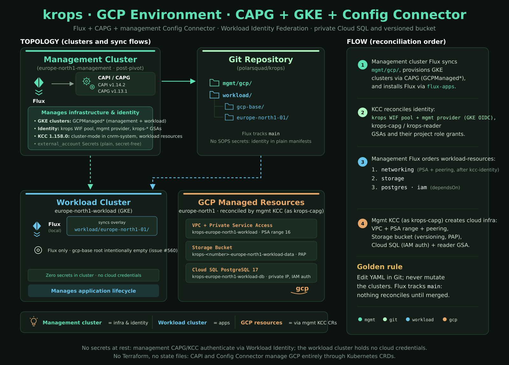

# GCP environment

The `gcp` environment mirrors `azure`: a kind bootstrap cluster runs Flux,
CAPG builds a GKE management cluster, and the pivot moves the management
objects into it. The management cluster's Config Connector (KCC)
reconciles the GCP workload resources (PSA range, bucket, Cloud SQL,
reader GSA) from
`mgmt/gcp/infrastructure/workload-resources/` (issue #560: the workload
clusters no longer run their own Config Connector).

| AWS (`aws`) | Azure (`azure`) | GCP (`gcp`) |
|---|---|---|
| CAPA, `AWSManagedControlPlane` | CAPZ, `AzureASOManagedControlPlane` | CAPG v1.13.1-zonal.1 (fork, #641), `GCPManagedControlPlane` (GKE) |
| ACK controllers on the management cluster only (issue #346) | ASO bundled by CAPZ on the management cluster only (workload release removed, issue #559) | Config Connector (KCC 1.158.0) on the management cluster only (issue #560) |
| Static SOPS credentials on the management cluster (no EKS Pod Identity since issue #346) | Entra Workload Identity | Workload Identity Federation (WIF pool `krops`) |
| S3 bucket | Storage account + blob container | Storage bucket (versioning, uniform access, PAP) |
| RDS PostgreSQL | PostgreSQL Flexible Server | Cloud SQL (private IP, IAM auth) |
| IAM reader role | none yet (follow-up) | `krops-reader` GSA + per-cluster reader GSA |



## Prerequisites

- A GCP project with a billing account where you hold Owner (needed once,
  for `gcp-bootstrap`).
- A GitHub PAT and an age key as for `aws` (`.env`, see
  [operations.md](./operations.md)), and `GCP_PROJECT` set. No host
  toolchain: `gcloud` and `gke-gcloud-auth-plugin` are in the toolbox image.
- A gcloud session, created browser-less and persisted in the checkout's
  gitignored `.gcloud/` directory (`CLOUDSDK_CONFIG`), which the lifecycle
  wrapper also mounts so `wif-federate` and the GKE kubeconfig reuse it:

  ```sh
  docker run --rm -it -v "$PWD:/workspace" -w /workspace \
    -e CLOUDSDK_CONFIG=/workspace/.gcloud \
    --entrypoint gcloud "$TOOLBOX_IMAGE" auth login --no-launch-browser
  ```

- The one-time project preparation (enable the GKE/SQL/Storage/IAM/STS APIs,
  create the `krops-capg` / `krops-reader` service accounts with their
  project role grants, and create the `krops` workload identity
  pool):

  ```sh
  export GCP_PROJECT=<project-id>
  docker run --rm -it -v "$PWD:/workspace" -w /workspace \
    -e CLOUDSDK_CONFIG=/workspace/.gcloud -e GCP_PROJECT -e MISE_AUTO_INSTALL=0 \
    --entrypoint mise "$TOOLBOX_IMAGE" -E gcp run gcp-bootstrap
  ```

  It prints the values to commit; nothing it prints is secret (no service
  account key is ever created, issue #72).

## Commit the identifiers

1. `mgmt/gcp/infrastructure/gcp-vars/gcp-vars.yaml`: `GCP_PROJECT`,
   `GCP_PROJECT_NUMBER` (printed by `gcp-bootstrap`). The region (`europe-north1`)
   and zone (`europe-north1-a`) are committed constants.
2. `mgmt/gcp/addons/flux-apps/regions/europe-north1/cluster-vars.yaml`: the same
   `GCP_PROJECT` / `GCP_PROJECT_NUMBER` for the workload cluster.
3. Pick the GKE version: `gcloud container get-server-config --zone europe-north1-a`
   and set `version:` in
   `mgmt/gcp/clusters/europe-north1/{management,staging}/cluster.yaml`
   (control plane and every machine pool).

## Credentials

No GCP secret exists at rest. CAPG and the management-side Config Connector
authenticate through Workload Identity Federation: their service accounts
(`capg-system/capg-manager`, `cnrm-system/cnrm-controller-manager`) present
the cluster's projected token to the `krops` pool, and the
`external_account` JSON files in
`mgmt/gcp/capi-providers/capg-system/capg-wif-credentials.yaml` and
`mgmt/gcp/infrastructure/kcc/kcc-wif-credentials.yaml` (plain Secrets, not
keys) point at pool `krops`, provider `${GCP_WIF_PROVIDER:=mgmt}`, subject
restricted by `attributeCondition` to exactly those two service accounts.

- On the kind bootstrap cluster the provider is `kind`: the `wif-federate`
  mise task (run by bootstrap-rs as `post-kind-create-task`) uploads the
  kind cluster's OIDC JWKS as the pool's `kind` provider, grants
  `roles/iam.workloadIdentityUser` on `krops-capg` to both service-account
  subjects, and sets `GCP_WIF_PROVIDER=kind` in a `gcp-wif` ConfigMap that
  Flux substitution reads after `gcp-vars`.
- Post-pivot the provider is `mgmt`, declared in Git at
  `mgmt/gcp/infrastructure/kcc-identity/` (KCC-managed
  `IAMWorkloadIdentityPoolProvider` with the management cluster's OIDC
  issuer, `allowedAudiences` equal to the issuer). The pivot pins
  `GCP_WIF_PROVIDER=mgmt` through `pivot-manifest-vars` in `bootstrap.toml`
  because the source-side ConfigMap merge order cannot guarantee it.
- The CAPG credential additionally carries a `client_email` naming the
  impersonated `krops-capg` GSA. CAPG v1.13.1's kubeconfig-token path reads
  it to call iamcredentials GenerateAccessToken (self-impersonation,
  authorized by the existing project-level
  `roles/iam.serviceAccountTokenCreator` grant on `krops-capg`, issue #642).
  The token exchange itself ignores the field, so the design stays keyless.
  It becomes redundant once CAPG ships the upstream fix
  (kubernetes-sigs/cluster-api-provider-gcp@ef84466ae182, expected v1.14.0)
  and can be dropped then.

## Bootstrap, pivot, teardown

```sh
scripts/toolbox-run.sh bootstrap gcp     # kind + Flux + CAPG; then pivot into europe-north1-management
export KUBECONFIG="$PWD/.kube/krops-mgmt.yaml"   # written by the pivot, context krops-mgmt
docker run --rm -it \
  -v "$PWD:/workspace" -w /workspace \
  -v "$PWD/.kube:/root/.kube" \
  -e KUBECONFIG=/workspace/.kube/krops-mgmt.yaml -e KUBECONFIG_FILE=/root/.kube/krops-workloads.yaml \
  -e CLOUDSDK_CONFIG=/workspace/.gcloud -e MISE_AUTO_INSTALL=0 \
  --entrypoint mise "$TOOLBOX_IMAGE" -E gcp run kubeconfigs   # user kubeconfig Secrets; writes .kube/krops-workloads.yaml.<cluster>
```

The exported GKE kubeconfigs use `gke-gcloud-auth-plugin`, which the toolbox
carries; use them from a toolbox `kubectl` run with the same `.kube` and
`.gcloud` mounts, or install the plugin on the host.

Right after the kind cluster is created, bootstrap-rs runs the
`wif-federate` mise task (`post-kind-create-task` in `bootstrap.toml`):
it registers the kind cluster's OIDC provider and the two impersonation
bindings on `krops-capg`, and creates the `gcp-wif` ConfigMap. A recreated
kind cluster (new signing key) is healed by the JWKS re-upload on the next
run.

During the pivot the CLI applies the plain, secret-free WIF credential
Secrets and the `cnrm-system` namespace to the target before
`clusterctl move` (`pivot-manifests` in `bootstrap.toml`), with
`GCP_WIF_PROVIDER` forced to `mgmt` (`pivot-manifests` +
`pivot-manifest-vars`): the moved provider and Config Connector reference
the Secrets by name and clusterctl does not carry them.

Teardown is manual for now: `scripts/toolbox-run.sh teardown gcp` refuses
and prints
the steps (`teardown.manual` in `bootstrap.toml`). The `krops` pool, its
providers and the service accounts are deliberately left in place; they are
re-adopted on the next bootstrap.

## Reconciliation order

Management cluster: `gcp-vars` (the non-secret identifiers ConfigMap),
cert-manager, capi-operator, capi-system, capg-system (health checks wait
for the GCPManaged* CRDs), caaph-system, kcc-operator (waits for the
operator StatefulSet), kcc (the `cnrm-system` ConfigConnector), kcc-identity
(the `krops` pool, `mgmt` provider and GSA grants, managed by KCC),
workload-resources (the per-workload-cluster cloud resources, issue #560:
networking (Private Service Access), storage (bucket), postgres (Cloud
SQL, depends on networking), iam (per-cluster reader), all depending on
kcc-identity), europe-north1 (clusters), flux-apps. The `kcc` and
`capg-system` Kustomizations substitute from `gcp-vars` plus the optional
`gcp-wif` ConfigMap, so their first reconcile on a fresh source can fail
once and succeeds on the 2-minute retry.

Workload cluster: Flux only, ready for a future application workload
(its gcp-base root is intentionally empty, issue #560).

## Upgrading CAPG and the Config Connector operator

CAPG is pinned to the fork release `shrinedogg/cluster-api-provider-gcp`
v1.13.1-zonal.1 (fetched via `fetchConfig`), not upstream: upstream
resolves node pools against the zone-stripped regional path, so node pools
of the zonal clusters never converge (#641). Re-point at upstream once a
release there includes the zonal node-pool fix (retirement tracked in
issue #656).

CAPG minors: merge one at a time and let the management cluster settle
before the next (GKE and MachinePool are feature-gated, see
`capi-providers/capg-system/capg-variables.yaml`).

The Config Connector operator is deployed via Flux HelmRelease, consuming
the published Helm chart from `lioramilbaum/config-connector-helm`. The
OCIRepository (`mgmt/gcp/infrastructure/kcc-operator/ocirepository.yaml`) pins
both `ref.tag` and `ref.digest`; Renovate's native Flux manager bumps them
together in one edit, and `tests/test-gcp-kcc-operator-pin.py` (in
`mise run validate` and CI) guards the digest and cosign pin against
regression. The chart is fetched and installed automatically on the
next Flux reconciliation.

## Known limitations

- Cloud SQL creates the built-in `postgres` user with no password, and it
  cannot log in. [Known issues registry](./known-issues.md#gcp).
- Acceptance is pending the re-run after the CAPG fixes. [Known issues
  registry](./known-issues.md#gcp).
- Zonal clusters (`europe-north1-a`) until multi-zone availability in the
  project is confirmed. [Known issues registry](./known-issues.md#gcp).
- Cloud SQL instance names have a reuse cooldown after deletion. [Known
  issues registry](./known-issues.md#gcp).
- The `kind` WIF provider stays in the pool after the pivot (harmless).
  [Known issues registry](./known-issues.md#gcp).
- GKE Autopilot and GPU pools are follow-ups. [Known issues
  registry](./known-issues.md#gcp).
